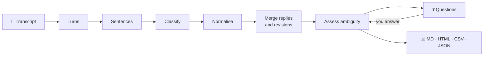

<div align="center">

# 🔍 MeetLens

### Meetings end. Work should begin.

**Drop in a transcript. Get decisions, tasks, owners and deadlines back, and a sharp question for everything that's still missing.**


*Project 01 · Problem statement M1-P2 · AI-Powered Meeting-to-Action Assistant*

</div>

---

## 💡 The idea in one breath

> Most meetings don't fail in the discussion. They fail in the **gaps**:
> a task nobody owns, a deadline nobody wrote down, a *"we should look into that"* that goes nowhere.

Other tools summarise. **MeetLens interrogates.** It finds every gap and asks you a specific question about it, then re-checks once you answer.

And it never makes things up. If the transcript doesn't name an owner or a date, MeetLens says so instead of guessing.

---

## ⚡ Try it in 60 seconds

```bash
git clone https://github.com/manishchandraraturi/meetlens.git
cd meetlens
python -m meetlens serve
```

Open **http://127.0.0.1:8000** → pick **Sprint Planning** → **Analyse** → answer the questions → **Apply answers**.

No API key. No internet. No `pip install`. Just Python.

<details>
<summary><b>🎮 More ways to play (click to expand)</b></summary>

<br>

```bash
python -m meetlens demo                                   # analyse every sample into output/
python -m meetlens analyze samples/club_event.txt --ask   # answer questions right in the terminal
python -m unittest discover -s tests                      # 33 unit tests
python eval/gold.py -v                                    # accuracy on hand-labelled transcripts
```

Needs Python 3.8 or newer.

</details>

---

## 🎬 See it work

**You paste a messy sprint meeting:**

```text
[10:04] Priya:   That is a blocker for the demo. Rahul, can you fix the two-column issue by Friday?
[10:05] Rahul:   Yes, I'll fix it by Friday and push the patch to the main branch.
[10:08] Priya:   Someone should write the test cases for the login flow.
[10:09] Karthik: Maybe I can look at it if I get time.
[10:19] Rahul:   Sure. She should also collect feedback from last sprint's users.
```

**MeetLens hands back a clean action board:**

| ID | Task | Owner | Deadline | Priority | Status |
|----|------|-------|----------|----------|--------|
| A1 | Fix the two-column issue and push the patch to the main branch | Rahul Verma | Fri, 23 Oct 2026 | 🔴 High | ✅ Ready |
| A2 | Write the login test cases | Karthik Iyer | Mon, 26 Oct 2026 | 🟡 Medium | ✅ Ready |
| A3 | Figure out the database hosting | ❓ Unassigned | – | 🟡 Medium | 🟠 Needs clarification |
| A6 | Collect feedback from last sprint's users | ❓ *(she)* | – | 🟡 Medium | 🟠 Needs clarification |

**…and then it talks back:**

> 🗣️ *"the team" is not a single person. Who will own "Figure out the database hosting"?*
>
> 🗣️ *Who does "she" refer to for the task "Collect feedback from last sprint's users"?*

### 📈 The payoff

After answering the 11 questions it asked on this sample:

```
Fully specified tasks   30% ██████░░░░░░░░░░░░░░  →  100% ████████████████████
```

Full generated reports for every sample live in [`output/`](output/) as **Markdown, HTML, CSV and JSON**.

---

## 🧠 What it understands

<details open>
<summary><b>📌 Action items</b></summary>

<br>

`"I'll send it"` · `"Rahul, can you fix it"` · `"Ananya will prepare slides"` · `"we should book the hall"` · `"the report needs to be sent"` · `Action item: ...`

</details>

<details>
<summary><b>💬 Replies &amp; revisions</b></summary>

<br>

- `"Yes, I'll do it by Friday"` is merged into the request it answers, so it isn't counted twice.
- `"Actually, make it Monday"` updates the earlier task and **records what changed**.

</details>

<details>
<summary><b>📅 Deadlines</b></summary>

<br>

`by Friday` · `next Monday` · `in 2 weeks` · `25th October` · `by the 18th` · `EOD`

Words like **"soon"** and **"ASAP"** are flagged as *not a real date*.

</details>

<details>
<summary><b>✅ Decisions</b></summary>

<br>

Picks up `"we've decided..."`, and also proposals someone else confirmed (`"Agreed"`), together with the reason.

</details>

<details>
<summary><b>🚩 Ambiguity detection</b></summary>

<br>

| Red flag | Example |
|----------|---------|
| No owner | *"Someone should write the tests"* |
| Group owner | *"The team will handle it"* |
| Unresolved pronoun | *"She will collect feedback"* |
| No deadline | task with no date at all |
| Vague deadline | *"soon"*, *"ASAP"* |
| Vague task | *"look into that"* |
| Tentative | *"Maybe I can look at it"* |
| Deadline already passed | date earlier than the meeting |

</details>

<details>
<summary><b>🔗 Follow-ups</b></summary>

<br>

Next meeting, open issues, unanswered questions, and dependencies such as *"once the patch is merged"*.

</details>

Every task gets a **confidence score** and a status: `ready` or `needs_clarification`.

---

## ⚙️ How it works



### Why rules and not an LLM? Because we chose to.

| | Rule-based (MeetLens) | Typical LLM wrapper |
|---|---|---|
| **Same input, same output** | ✅ Always | ❌ Varies run to run |
| **Explainable** | ✅ Every result traces to a sentence and a rule | ❌ Black box |
| **Needs internet / API key** | ✅ No | ❌ Yes |
| **Cost per meeting** | ✅ Zero | ❌ Per token |
| **Privacy** | ✅ Transcript never leaves your machine | ❌ Sent to a third party |

Extraction and ambiguity checking are deliberately **separate modules**, so a language model could replace extraction later without touching the clarification logic.

<details>
<summary><b>🗂️ Project layout</b></summary>

<br>

```text
meetlens/
├── engine.py     parsing, extraction, ambiguity assessment, clarification loop
├── dates.py      deadline and date understanding
├── report.py     Markdown / HTML / CSV / JSON export
├── server.py     web server (stdlib only)
├── ui.html       the interface
└── cli.py        command line
samples/          demo transcripts
eval/             evaluation transcripts + gold labels
tests/            33 unit tests
```

</details>

<details>
<summary><b>📝 Transcript format</b></summary>

<br>

```text
Title: Sprint Planning
Date: 2026-10-20
Attendees: Priya Nair, Rahul Verma

[10:02] Priya: Rahul, can you fix the parser by Friday?
Rahul: Yes, I'll fix it by Friday.
```

Title, Date, Attendees and timestamps are optional. The date is what relative deadlines are measured from.

</details>

---

## 🧪 Evaluation (the honest numbers)

We hand-labelled **owner, date and task for 34 tasks across 6 transcripts**, then measured, fixed what broke, and measured again.

| Run | Recall | Precision | Owner + date correct |
|-----|:------:|:---------:|:--------------------:|
| Second set, first run | 90% | 64% | 20% |
| Unseen transcript, first run | 100% | 71% | 80% |
| **After fixing the bugs those runs exposed** | **100%** | **83–100%** | **90–100%** |

> 🔎 **A note on honesty:** the development transcripts score 100% because the rules were written against them, so we **don't** quote that as accuracy. The test sets are small and written by the author. The table above is the story of the pipeline improving after meeting data it hadn't seen.

---

## 🛣️ Known limits and roadmap

We'd rather tell you what MeetLens can't do yet than have you discover it.

- [ ] Link related tasks that share no words (*"inform the students"* ↔ *"put up a notice"*)
- [ ] Support multiple owners per task (currently one)
- [ ] Resolve pronouns across longer distances (currently nearby sentences)
- [ ] Handle transcripts without speaker labels and non-English meetings
- [ ] Offer both readings of *"next Friday"* (currently: Friday of next week)
- [ ] Optional LLM extractor plugged in behind the same clarification loop

---

## 👤 Author

**Manish** · B.E. AI & ML · CMR Institute of Technology, Bengaluru

## 📄 License

MIT
